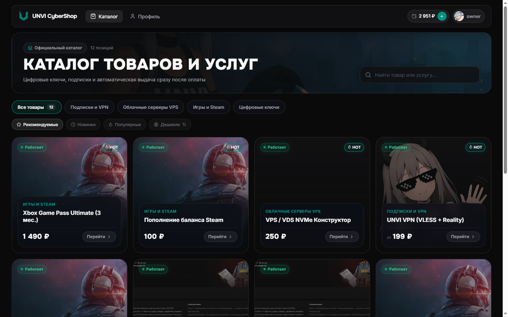
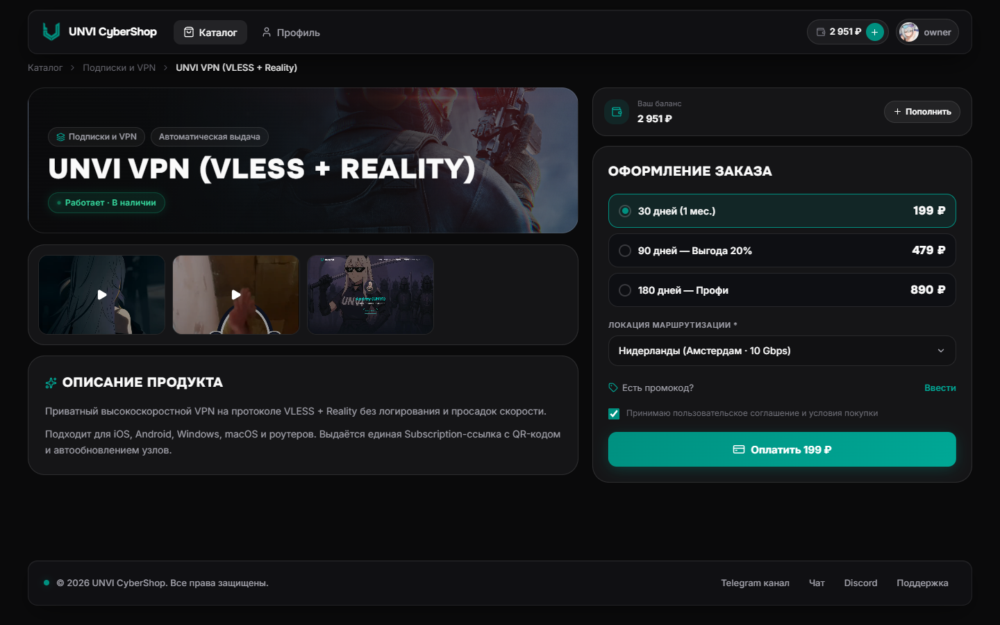
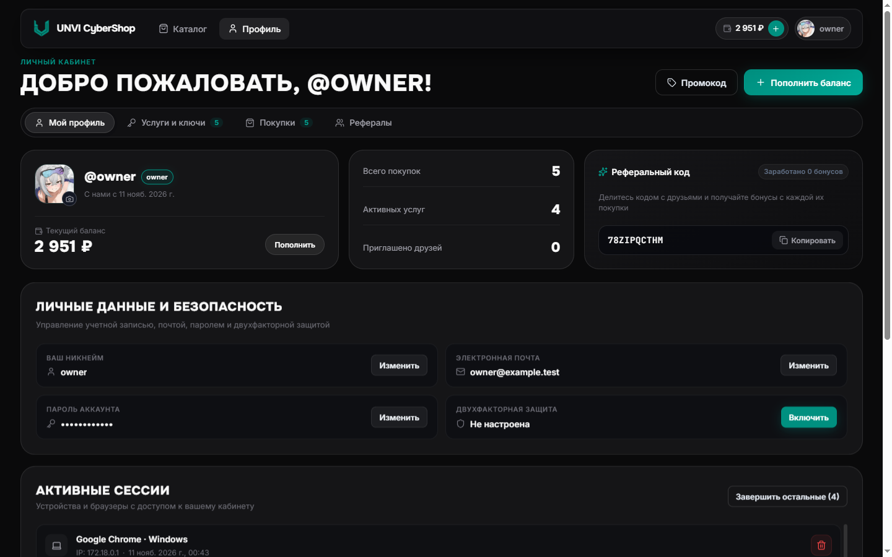
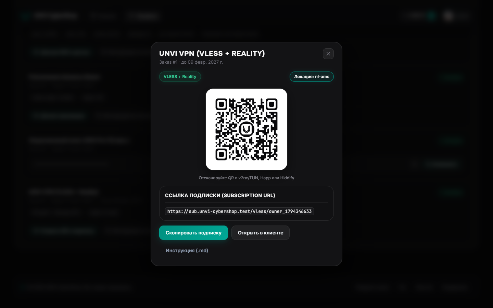

# SBPersonalAccountClient

Официальный личный кабинет и витрина покупателя для платформы [**SaviorBill**](https://github.com/UNVISLATE/SaviorBill). Позволяет клиентам просматривать каталог цифровых товаров, оформлять и оплачивать заказы, активировать промокоды, пополнять баланс и управлять выданными подписками, ключами и услугами.

---

## Интерфейс

| Каталог товаров | Страница товара и тарифов |
| :---: | :---: |
|  |  |

| Профиль и баланс | Выданная услуга и QR-подписка (`sbuiSDK`) |
| :---: | :---: |
|  |  |

---

## Стек и ключевые особенности

- **Frontend:** React 19 · TypeScript · Vite · SCSS / Tailwind utilities · TanStack Query · React Router 7 · Motion · Lenis
- **Server-Driven UI (`vendor/sbuiSDK`):** динамический рендеринг карточек, форм, инструкций, бейджей и брендированных QR-кодов (`QRCode`, `SchemaRenderer`) на основе JSON-манифестов, приходящих от бэкенда SaviorBill и Lua-скриптов без пересборки клиента.
- **Гибкое ценообразование на витрине:** поддержка товаров типов `fixed`, `tiered` (тарифы), `custom` (произвольная сумма) и `configurable` (интерактивный конструктор ресурсов с моментальным пересчётом цены).
- **Динамическое брендирование:** название, логотип, цветовая схема и ссылки подтягиваются с сервера SaviorBill по API; runtime-эндпоинты передаются при старте контейнера через `env-config.js`.
- **Авторизация и безопасность:** вход/регистрация, OAuth/OIDC, двухфакторная аутентификация (2FA), управление активными сессиями, история платежей и реферальная программа.

---

## Развёртывание в Docker

Готовые образы публикуются в GitHub Container Registry при выпуске релизов:

```bash
docker pull ghcr.io/unvislate/sbpersonalaccountclient:latest
```

При установке SaviorBill через официальный скрипт `deploy/setup.sh` достаточно выбрать пункт `1 — Личный Кабинет`: скрипт автоматически добавит сервис в compose-стек и настроит проксирование к API биллинга.

### Переменные окружения контейнера (`runtime`)

Контейнер `nginx` при запуске генерирует `/usr/share/nginx/html/env-config.js` скриптом `docker-entrypoint.d/40-env-config.sh`:

| Переменная | Назначение | По умолчанию |
| --- | --- | --- |
| `VITE_API_BASE_URL` | Базовый URL API SaviorBill | `/api/v1` |
| `VITE_MEDIA_BASE_URL` | Базовый URL медиа-сервера | `/api/media` |
| `VITE_AUTH_BASE_URL` | Опциональный URL сервиса авторизации | *(пусто)* |

---

## Локальная разработка

Репозиторий использует сабмодуль `vendor/sbuiSDK`. Клонируйте с `--recurse-submodules`:

```bash
git clone --recurse-submodules https://github.com/UNVISLATE/SBPersonalAccountClient.git
cd SBPersonalAccountClient
npm ci
npm run dev
```

По умолчанию Vite-прокси направляет запросы `/api` и `/media` на локальный стек SaviorBill (порт `5174` -> API на `8000` / медиа на `8001` — при необходимости настройте `.env.local` или `vite.config.ts`).

Проверка перед коммитом:

```bash
npm run typecheck
npm run lint
npm run build
```

---

## Лицензия

Проект распространяется под лицензией **Apache License 2.0** — см. [`LICENSE`](./LICENSE).

Copyright © 2026 [UNVISLATE](https://github.com/UNVISLATE)
